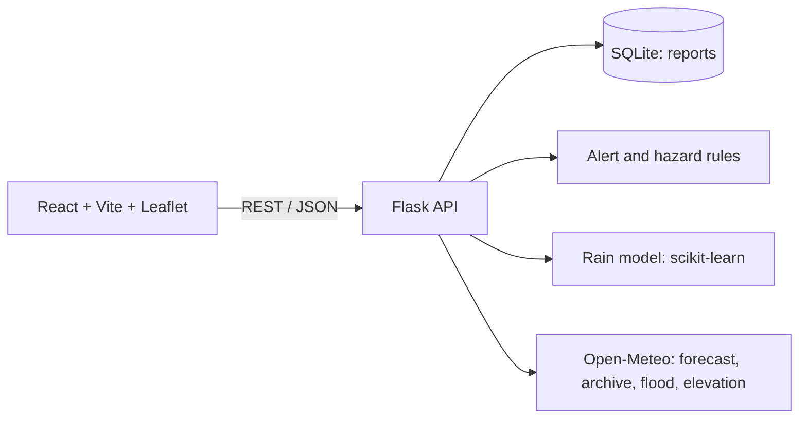

# ResQnet

[](https://github.com/zaynsblessings777/resqnet/actions/workflows/ci.yml)


**A disaster-response dashboard that turns live weather data into alerts, a machine-learning rain outlook, and flood and landslide risk screening, and lets people report emergencies on a map.**

Built as a university project (B.Tech CSE, Sharda University) with a Flask API and a React dashboard. It is a working prototype, **not** a certified warning system. See [Limitations](#limitations).

<!-- Team: add names here if you want them listed -->

## Screenshots

| Dashboard | Flood and landslide risk |
|---|---|
|  |  |
| **Emergency alerts** | **Rescue reports** |
|  |  |

## What is real and what is not

| Feature | Status | How it works |
|---|---|---|
| Weather and live map | Working | Open-Meteo forecast data, Leaflet and OpenStreetMap |
| Emergency alerts | Working, rule-based | 24 h forecast rain, wind and heat compared with fixed thresholds |
| AI rain outlook | Working, **machine learning** | Gradient-boosting model, 24 h rain probability, trained on 10 years of ERA5 data |
| Flood risk | Working, rule-based | Forecast river discharge against 2-, 5- and 20-year flood levels |
| Landslide risk | Working, rule-based | Rainfall against a global landslide threshold, limited by terrain slope |
| Rescue reports | Working | Form with coordinates, stored in SQLite, shown as map pins |
| Relief centres | **Not built** | The dashboard card shows sample data |
| Push notifications, accounts, offline mesh | Planned | See [Roadmap](#roadmap) |

Only the rain outlook is machine learning. The flood and landslide features are deliberately **not** ML: there are no labelled flood or landslide records in this project to train on, so they use published methods and show the rule behind every result.

## How the risk logic works

**Alerts** (`backend/alerts.py`). Rain follows IMD 24-hour rainfall categories (15.6, 64.5, 115.6 and 204.5 mm). Wind follows the Beaufort scale applied to gusts (50, 62 and 89 km/h). Heat follows IMD maximum-temperature thresholds (40, 45 and 47 °C, without IMD's departure-from-normal and multi-day checks).

**Rain outlook** (`backend/ml/`). Predicts whether at least 2.5 mm of rain will fall in the next 24 hours, from recent pressure, humidity, dew point, cloud, wind, recent rain and time of year. Training is time-based (train before 2023, validate 2023, test 2024 onwards) and compared against two baselines. In the November 2026 training run on Greater Noida:

| | ROC-AUC | Average precision | Brier score (lower is better) |
|---|---|---|---|
| **Model** | **0.914** | **0.727** | **0.092** |
| Rained in the last 24 h | 0.862 | 0.619 | not applicable |
| Typical rain for the month | 0.836 | 0.525 | 0.120 |

The gain over the baselines is real but modest, because rain here is strongly seasonal. Scores depend on the data window, so retraining gives slightly different numbers. The model card with the full results is written to `backend/ml/models/rain_model_card.json`.

**Flood risk** (`backend/hazards.py`). Open-Meteo serves GloFAS river discharge. A Gumbel distribution is fitted to about 39 yearly peaks (1984-2022) of the nearest river to find the 2-, 5- and 20-year flood levels. Risk is how high the 7-day forecast climbs against them.

**Landslide risk** (`backend/hazards.py`). Rain over 24 h and 72 h is compared with Caine's (1980) global minimum threshold, I = 14.82 D^-0.39. Terrain slope comes from a 90 m elevation model. The level is limited by the weaker of the two factors. This combination rule is a simplified screening heuristic and is not calibrated. A "what-if" panel lets you try rainfall scenarios.

## Architecture



```
backend/
  app.py              Flask app and routes
  alerts.py           rule-based weather alerts
  hazards.py          flood and landslide logic (pure functions)
  hazard_routes.py    flood and landslide endpoints and data fetching
  ml/                 features, training script, predictor, tests
  test_*.py           tests that need no internet
frontend/
  src/                React components, API client, styles
```

## Getting started

You need Python 3.10+ and Node.js 22 (LTS) or newer.

**Backend**

```bash
cd backend
python3 -m venv venv
source venv/bin/activate          # Windows: venv\Scripts\activate
pip install -r requirements.txt
python3 app.py                    # http://127.0.0.1:5000
```

**Train the rain model** (needs internet, takes a few minutes, optional)

```bash
python3 ml/train_rain_model.py
```

Without a trained model the rest of the app works, and the AI Rain Outlook panel tells you to train it.

**Frontend**

```bash
cd frontend
npm install
npm run dev                       # http://localhost:5173
```

To point the frontend at a different backend, copy `frontend/.env.example` to `frontend/.env` and edit `VITE_API_URL`.

## API

| Method | Endpoint | Purpose |
|---|---|---|
| GET | `/` | Health check |
| GET | `/weather?latitude=&longitude=` | Current conditions |
| GET | `/alerts?latitude=&longitude=` | Rule-based alerts for the next 24 h |
| GET | `/predict/rain?latitude=&longitude=` | ML rain probability (within 100 km of the training location) |
| GET | `/hazards/flood?latitude=&longitude=` | Flood risk for the nearest river |
| GET | `/hazards/landslide?latitude=&longitude=` | Landslide risk; add `scenario_rain_24h` and `scenario_rain_72h` for a what-if |
| GET, POST | `/reports` | List and submit emergency reports |

Report timestamps are stored in UTC.

## Tests

```bash
cd backend
python3 test_alerts.py
python3 test_hazards.py
python3 ml/test_ml_pipeline.py    # uses synthetic data, so it checks the code, not model quality

cd ../frontend
npm run lint
npm run build
```

The same checks run on every push through GitHub Actions.

## Limitations

- **Not an official warning system.** Do not rely on it in a real emergency. For warnings, use IMD, the Geological Survey of India and local authorities.
- **The rain model covers one location** (Greater Noida) and refuses locations more than 100 km away. It is trained on ERA5 reanalysis but runs on live model data, which differ slightly, and it is weaker than a physical weather forecast.
- **Flood data is simulated discharge, not gauge readings.** GloFAS does not fully represent dams, barrages and water withdrawals, so heavily managed rivers such as the Yamuna can differ from reality.
- **Landslide thresholds are global minimums.** Local thresholds, soil, geology and past slope failures are not considered.
- **Prototype security.** There is no authentication, and `python3 app.py` runs Flask's development server in debug mode. Do not expose it to the internet.

## Roadmap

- Relief-centre database and page
- Push or SMS notifications for new alerts
- User accounts and roles
- Offline reporting and peer-to-peer mesh sharing
- Trained flood and landslide models, if labelled event data becomes available
- Monitoring more than one location

## Data sources

Weather, archive, flood and elevation data come from [Open-Meteo.com](https://open-meteo.com/) (CC BY 4.0), which serves GloFAS river discharge from the Copernicus Emergency Management Service and Copernicus DEM elevation. Map tiles are from OpenStreetMap contributors, rendered with Leaflet.

## License

[MIT](LICENSE)
